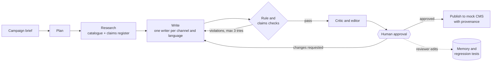

# Campaign Content Agent

An AI agent that turns a marketing campaign brief into an **approved, on-brand, claim-checked content pack**: a LinkedIn post, a newsletter section and a product blurb, in English and French.

> **Status:** work in progress. Milestone 1 (MVP) is under construction. See the [roadmap](#roadmap).

## Why this project

Writing "in a brand's voice" is now a built-in feature of most AI content tools. The hard problems teams face in 2026 are elsewhere:

- **Reliability.** An agent has to complete a multi-step job, not just generate one good paragraph.
- **Truth and compliance.** Every product, performance and environmental claim must be backed by evidence. Since 27 September 2026, EU Directive 2024/825 bans generic environmental claims such as "eco-friendly".
- **Security.** Briefs and web pages can carry prompt-injection attacks.
- **Evaluation.** Quality has to be measured on real runs, not judged by eye.
- **Traceability.** Who approved what, which model wrote it, and which version of the brand rules applied.

This project builds an agent that handles all five, and measures how much each component adds.

## How it works



1. **Plan:** split the brief into tasks for each channel and language.
2. **Research:** look up product facts and approved claims. The brief and any web content are treated as untrusted data, never as instructions.
3. **Write:** draft each piece in the brand's voice, using a versioned **voice spec** and retrieved on-brand examples.
4. **Check:** enforce hard rules in code (banned words, glossary, spelling, length, reading level) and match every claim against an **approved claims register**. Failures go back to the writer with the exact problems.
5. **Critic and editor:** score soft qualities ("warm, not gushing") and revise weak points.
6. **Human approval:** the run pauses; the reviewer sees scores, claim evidence and changes.
7. **Publish:** write to a mock CMS with provenance: model, voice-spec version, approver, time.
8. **Learn:** reviewer edits become memory, new examples and regression tests.

Full design: [docs/design.md](docs/design.md).

## Stack

Python 3.13 · LangGraph · Microsoft Foundry (Claude Haiku 5.5 writer, GPT-6 Luna checker, text-embedding-3-large) · Postgres + pgvector · LangSmith · Pydantic · pytest · GitHub Actions · Docker Compose · uv

## Roadmap

- [ ] **Milestone 1: MVP.** Brief → English LinkedIn post and product blurb for one brand, with voice spec, rule and claims checks, human approval, tracing and an ablation table.
- [ ] **Milestone 2: evaluation hardening.** Red-team prompt-injection set, consistency across repeated runs, CI quality gates.
- [ ] **Milestone 3: stretch.** MCP tool servers, French output, a second brand, reviewer memory, a review UI, cost routing dashboard.

## Results

*Coming with Milestone 1:* the ablation table (plain prompt → full agent), claim accuracy, prompt-injection success rate, consistency across runs and cost per approved piece.

## Quickstart

Prerequisites and Azure setup: [docs/setup.md](docs/setup.md).

```bash
uv sync                                 # install dependencies
cp .env.example .env                    # then fill in your Foundry key and endpoints
docker compose up -d                    # Postgres + pgvector
uv run python scripts/check_setup.py   # verify everything is connected
uv run pytest
```

## Licence

MIT
